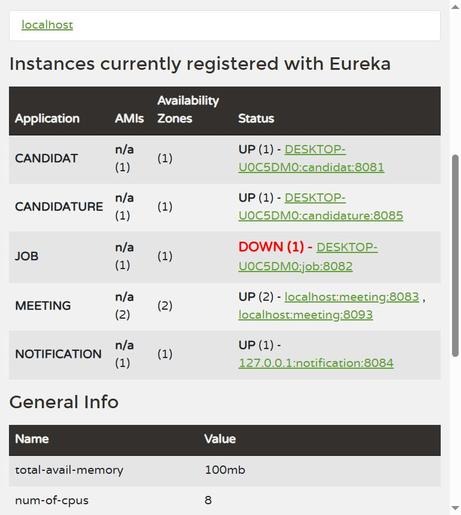

# Architecture Web Distribuée – Atelier Eureka

Projet backend en microservices : un serveur de découverte **Eureka** et cinq microservices (Spring Boot, Node.js et Python) qui s'y enregistrent.

## Membres de l'équipe

- Aimen Boudhrioua
- _(à compléter)_

## Architecture

| Microservice | Technologie | Port | Nom dans Eureka |
|---|---|---|---|
| Eureka Server | Spring Boot | 8761 | – |
| Candidat | Spring Boot + H2 | 8081 | CANDIDAT |
| Job | Spring Boot + MySQL | 8082 | JOB |
| Candidature | Spring Boot | 8085 | CANDIDATURE |
| Meeting | Node.js / Express | 8083 (+ 8093) | MEETING |
| Notification | Python / FastAPI | 8084 | NOTIFICATION |

## Dashboard Eureka

Les services CANDIDAT, CANDIDATURE, JOB, MEETING (2 instances : 8083 et 8093) et NOTIFICATION enregistrés en même temps :


## Lancement

Sous Windows, double-cliquer sur `start-all.bat` (les logs sont écrits dans `logs/`), puis ouvrir http://localhost:8761.

Ou manuellement :

```bash
# Eureka
cd eureka && mvnw spring-boot:run
# Candidat / Job / Candidature
cd microservices/candidat && mvn spring-boot:run
# Meeting (2 instances)
cd microservices/meeting && npm install
PORT=8083 npm start
PORT=8093 npm start
# Notification
cd microservices/notification && pip install -r requirements.txt
PORT=8084 python -m app.main
```

Job nécessite MySQL (base `job_db`, script `microservices/job/database/job_db.sql`).

## Vérification

- http://localhost:8761 – dashboard Eureka
- GET http://localhost:8083/api/meetings/hello
- GET http://localhost:8084/api/notifications/hello

---

# Atelier 2 – Observabilité avec Spring Boot Actuator

## Configuration

- **Candidat, Job, Candidature** : dépendance `spring-boot-starter-actuator` et, dans `application.properties` :
  `management.endpoints.web.exposure.include=health,info,metrics`, `management.endpoint.health.show-details=always`,
  `eureka.client.healthcheck.enabled=true`, `management.info.env.enabled=true` et les propriétés `info.app.*`.
- **Meeting (Node.js)** : routes `GET /health` → `{"status":"UP"}` et `GET /info` (nom et version lus dans `package.json`) ;
  `healthCheckUrl` et `statusPageUrl` déclarés dans `src/config/eureka.js`.
- **Notification (Python)** : routes `GET /health` et `GET /info` dans `app/main.py` ;
  `health_check_url` et `status_page_url` déclarés dans `app/eureka.py`.

## Endpoints

| Service | Health | Info |
|---|---|---|
| Candidat | http://localhost:8081/actuator/health | http://localhost:8081/actuator/info |
| Job | http://localhost:8082/actuator/health | http://localhost:8082/actuator/info |
| Candidature | http://localhost:8085/actuator/health | http://localhost:8085/actuator/info |
| Meeting | http://localhost:8083/health | http://localhost:8083/info |
| Notification | http://localhost:8084/health | http://localhost:8084/info |

Vérification dans le registre : `GET http://localhost:8761/eureka/apps/NOTIFICATION` renvoie
`healthCheckUrl=http://localhost:8084/health` et `statusPageUrl=http://localhost:8084/info`.

## Panne de la base MySQL (Job)

Après l'arrêt de MySQL, `/actuator/health` de Job renvoie `DOWN` (HTTP 503, composant `db` en erreur)
et Eureka affiche **JOB DOWN**. Au redémarrage de MySQL, Job repasse **UP**.



## Question sur les métriques

Mesures relevées sur `http://localhost:8081/actuator/metrics/http.server.requests` après quelques appels à `GET /api/candidates` :

- **COUNT = 5** requêtes HTTP traitées par Candidat ;
- **MAX = 0,1999 s**, soit environ 200 ms pour la requête la plus lente ;
- `?tag=status:200` renvoie les mêmes mesures, limitées aux requêtes terminées avec le code 200.
  Ici toutes les requêtes ont réussi : COUNT = 6, car l'appel précédent à `/actuator/metrics` est aussi compté.
