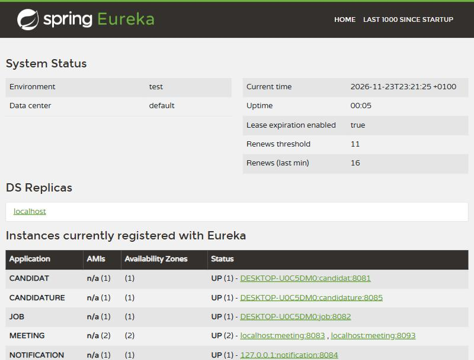

# Architecture Web Distribuée – Atelier Eureka

Projet backend en microservices : un serveur de découverte **Eureka** et cinq microservices (Spring Boot, Node.js et Python) qui s'y enregistrent.

## Membres de l'équipe

- Aimen Boudhrioua
- _(à compléter)_

## Architecture

| Microservice | Technologie | Port | Nom dans Eureka |
|---|---|---|---|
| Eureka Server | Spring Boot | 8761 | – |
| Candidat | Spring Boot + H2 | 8081 | CANDIDAT |
| Job | Spring Boot + MySQL | 8082 | JOB |
| Candidature | Spring Boot | 8085 | CANDIDATURE |
| Meeting | Node.js / Express | 8083 (+ 8093) | MEETING |
| Notification | Python / FastAPI | 8084 | NOTIFICATION |

## Dashboard Eureka

Les services CANDIDAT, CANDIDATURE, JOB, MEETING (2 instances : 8083 et 8093) et NOTIFICATION enregistrés en même temps :



## Lancement

Sous Windows, double-cliquer sur `start-all.bat` (les logs sont écrits dans `logs/`), puis ouvrir http://localhost:8761.

Ou manuellement :

```bash
# Eureka
cd eureka && mvnw spring-boot:run
# Candidat / Job / Candidature
cd microservices/candidat && mvn spring-boot:run
# Meeting (2 instances)
cd microservices/meeting && npm install
PORT=8083 npm start
PORT=8093 npm start
# Notification
cd microservices/notification && pip install -r requirements.txt
PORT=8084 python -m app.main
```

Job nécessite MySQL (base `job_db`, script `microservices/job/database/job_db.sql`).

## Vérification

- http://localhost:8761 – dashboard Eureka
- GET http://localhost:8083/api/meetings/hello
- GET http://localhost:8084/api/notifications/hello
